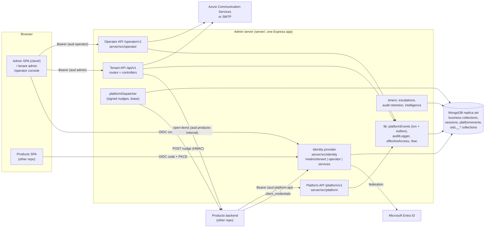

# Architecture

How the Admin repo is put together, read from the code on `main`. Paths are repo-relative. This file covers the repo as a whole; product detail is in [identity](identity/README.md), [admin-center](admin-center/README.md), [command-center](command-center/README.md) and [platform-api](platform-api/README.md). Environment: [CONFIGURATION.md](CONFIGURATION.md).

---

## 1. Components

One Node process (`server/`, Express 5 + TypeScript + Mongoose 9) serves four surfaces on one port, and one React SPA (`client/`, Vite + React 19 + Tailwind 4) serves two consoles.

| Surface | Mount | Caller | Auth |
|---|---|---|---|
| Identity provider (3 realms) | `/realms/tenant`, `/realms/operator`, `/realms/services` | browsers (hosted pages), SPAs (OIDC), service clients | own (oidc-provider) |
| Tenant API | `/api/v1` | Admin SPA (`/`) | tenant access token, aud `urn:karbexa:admin` (`requireAuth`) |
| Operator API | `/operator/v1` | Admin SPA (`/operator`) | operator access token, aud `urn:karbexa:operator` (`requireOperator`) + IP allow-list |
| Platform API | `/platform/v1` | products backend | services token, aud `urn:karbexa:platform-api` (`authenticateService` + scopes) |

Background work started in `server/src/index.ts` after `listen`: escalations every 5 min (`lib/escalationEngine.ts`), audit retention every 24 h and at start (`lib/auditRetention.ts`), intelligence rules for all companies every 60 s and at start (`lib/intelligence.ts`), platform event nudge dispatcher (`lib/platformDispatcher.ts`, every 2 s by default).



## 2. Folder map

### `server/src`

| Folder / file | Holds |
|---|---|
| `index.ts` | Loads `.env`, connects Mongo, builds the app, starts listening and the background timers and dispatcher |
| `app.ts` | `createServer()`: middleware order and mounts (section 3). Also used in-process by the smoke scripts |
| `config/db.ts` | `connectDB()` (`MONGODB_URI`, `DB_NAME`) |
| `constants/` | `roles.ts` (`ROLES`, `PERMISSION_GROUPS`), `timezones.ts` |
| `routes/` | One router per tenant area, combined in `routes/index.ts` under `/api/v1` |
| `controllers/` | Tenant API handlers (`*.controller.ts`); `__tests__/` |
| `middleware/` | `auth.ts` (`requireAuth`), `requireRole.ts`, `rateLimiter.ts` (`globalLimiter`, `authLimiter`), `errorHandler.ts` |
| `models/` | Mongoose models, all imported by `models/index.ts` (imported once by `app.ts`) |
| `identity/` | OIDC provider per realm, hosted login and account pages, sessions, keys, storage adapter, page shell |
| `operator/` | Operator API router, `requireOperator`, operator hosted login, account lookup; `standalone.ts` (standalone portal registration, mounted by one `router.use` in `routes.ts`) |
| `platform/` | Platform API routers, service-token auth, per-client rate limits, outbound products token, open-items proxy, SSE stream tickets |
| `lib/` | Cross-cutting logic: `platformEvents.ts` (transactions, outbox, `app_access.changed`), `auditLogger.ts`, `effectiveAccess.ts`, `productCatalog.ts`, `rbac.ts` + `rbacCache.ts`, `roleHierarchy.ts`, `lifecycle.ts`, `invitations.ts` (`createInvitation`, `createInvitations`, `inviteLink`: the one place invitations are made) + `invitationJobs.ts` (reminder every 30 min, retention nightly), `platformDispatcher.ts` + `platformLease.ts` + `ssrfGuard.ts`, `emailService.ts` (accepts mail into the `EmailDelivery` outbox; `deliverNow` sends), `emailSender.ts` (5 s sender loop, retries at 1/5/30/120 min), `periodic.ts` (`every(name, ms, fn)`: interval job guarded by `platformLease`), `notificationEngine.ts`, `workflowEngine.ts`, `escalationEngine.ts`, `intelligence.ts`, `auditRetention.ts`, `dataGovernance.ts`, `cryptoService.ts`, `trustProxy.ts`, `seed.ts` + `seedRunner.ts`, `standalonePortals.ts` (standalone registration, OIDC client metadata, access gate, claims, launch URLs) + `backchannelLogout.ts` (logout tokens, one `Job` per client), `health/` (component checks incl. `standalone_portals`); `__tests__/` |
| `services/` | `contextEngine`, `customFieldValidation`, `locationSettings`, `slaCalculator`, `employeeId/` (ID format generator / validator) |
| `hooks/` | `locationPolicy.hooks.ts` |
| `utils/` | `AppError`, `asyncHandler`, `ipUtils`, `passwordPolicy`, `regex`, `sanitizeUserForAudit`, `securityPolicyUtils`, `slugify` |
| `types/express.d.ts` | `req.user` typing (`AdminClaim`); `req.operator` and `req.service` are declared in their middleware files |
| `scripts/` | Seeds (`seed-operator`, `seed-first-user`, `seed-products`, `seed-demo-*`, `seed-e11`), migrations, key generation, smoke tests (`smoke-oidc-login`, `smoke-sprint2`), ad-hoc test scripts |

`server/.local/` (git-ignored) holds dev signing keys and cookie keys generated on first start.

### `client/src`

| Folder | Holds |
|---|---|
| `main.tsx`, `App.tsx` | Entry, router (tenant routes under `AuthGuard` + `AdminShell`, operator routes under `OperatorGuard` + `OperatorLayout`) |
| `pages/` | One folder per area, `*Page.tsx` route components; `pages/operator/` for the console |
| `features/` | Per-area hooks (TanStack Query) and components: `apps`, `audit`, `auth`, `data-fields`, `groups`, `holidays`, `integrations`, `locations`, `notifications`, `operator`, `organization`, `overview`, `people`, `policies`, `roles`, `security`, `teams`, `work-schedules`, `workflows` |
| `components/layout/` | `AdminShell`, `Sidebar` (nav + logout), `TopBar`, `AppLauncher` (`/me/apps`), `AuthGuard` / `GuestGuard`, `AuthLayout` |
| `components/ui/` | Shared UI (tables, dialogs, `PermissionGate`, selectors, org chart, policy editor) |
| `lib/` | `oidc.ts` (PKCE login, token, refresh), `session.ts` (token store, renew timer, profile), `apiClient.ts` (axios + 401 refresh / re-login), `queryClient.ts`, `timezone.ts`, `utils.ts` |
| `store/` | Zustand: `useAuthStore` (tokens + profile, memory only), `useUIStore` |
| `hooks/` | Cross-area hooks (`useMyPermissions`, company settings helpers) |
| `constants/` | `routes.ts`, `roles.ts`, `queryKeys.ts`, `theme.ts`, `timezones.ts` |
| `services/`, `types/`, `utils/` | `locationsApi.ts`, shared types, `cn`, date formatting |

## 3. Request pipeline (`server/src/app.ts`)

`createServer()` runs, in this order:

1. `resolveTrustProxy()` (throws in production when `TRUST_PROXY` is unset or `true`).
2. `initIdentity()`: Node `require(esm)` check, identity config, realm keys, oidc adapter indexes, three providers. Needs an open Mongo connection.
3. `app.set('trust proxy', ...)`.
4. `app.use('/realms/operator', requireOperatorIp)`: operator IP allow-list for the whole operator realm.
5. `mountIdentity(app)`: tenant interaction routes, tenant account routes, operator interaction routes, then the provider callbacks at `/realms/tenant`, `/realms/operator`, `/realms/services`. Mounted **before** CORS / helmet / body parsers because oidc-provider parses its own bodies and sets its own CORS.
6. `cors(...)`: allow-list = `CLIENT_URL` (comma list, default `http://localhost:5173`) + `ADMIN_SPA_ORIGIN`; any origin only with `NODE_ENV=development` and `ALLOW_ANY_ORIGIN=true`; `credentials: true`; requests without `Origin` pass.
7. `helmet()`.
8. `express.json()`, `express.urlencoded({ extended: true })`, `cookieParser()`.
9. `globalLimiter` (per IP, 15 min; skips `OPTIONS` and `/platform/v1`).
10. `/api/v1` → `routes/index.ts`. Each area router applies `requireAuth` (usually `router.use(requireAuth)`) and per-route `requireRole(...)`.
11. `/operator/v1` → `operator/routes.ts` (correlation id, then `requireOperator`).
12. `/platform/v1` → `platform/index.ts` (correlation id, auth-failure limiter, `authenticateService`, per-client limiter, per-route scope).
13. `errorHandler`: `AppError` → its status and `{ success: false, error, code }`; `ZodError` → 400 `VALIDATION_ERROR` with `details`; Mongo duplicate key → 409 `DUPLICATE_KEY_ERROR`; Mongoose validation → 400; `CastError` → 404/400; otherwise 500 `INTERNAL_ERROR` (message hidden in production).

Platform API handlers mostly answer errors themselves with `{ error, code }` (no `success` field).

## 4. Auth flow: SPA → OIDC → token → `requireAuth`

1. `AuthGuard` (`client/src/components/layout/AuthGuard.tsx`) finds no access token in memory. If a refresh token is in memory it refreshes, else `startLogin(returnTo)` (`client/src/lib/oidc.ts`) stores PKCE verifier / state / nonce / return path in `sessionStorage` and redirects to `${VITE_OIDC_ISSUER}/oauth/authorize` with `client_id=karbexa-admin-spa`, `resource=urn:karbexa:admin`, `code_challenge_method=S256`.
2. The tenant realm runs the hosted login (password, then TOTP or enrolment, or Entra), see [identity/ARCHITECTURE.md](identity/ARCHITECTURE.md). On success the provider redirects to `/auth/callback?code=...`.
3. `CallbackPage` calls `completeLogin` (checks state, posts the code + verifier + resource to `/oauth/token`). `storeTokens` keeps access and refresh tokens in `useAuthStore` (memory only) and schedules a refresh 60 s before expiry. `loadProfile` calls `GET /api/v1/auth/me`.
4. While issuing the access token, `extraTokenClaims` (`server/src/identity/providers.ts`) re-checks access (`loadAccessContext`), upserts / slides the `Session` row (`_id = sid`), and adds `idn`, `org`, `sid`, `org_roles`, `authz_ver`, `amr`, `token_use`, `email`. Access tokens are RS256 JWTs with `typ: at+jwt`, valid 600 s.
5. `apiClient` sends `Authorization: Bearer <token>`. On 401 it refreshes once (unless the code is `SESSION_REVOKED`) and retries, else clears the session and restarts login.
6. `requireAuth` (`server/src/middleware/auth.ts`):
   - verifies the token locally against the tenant realm public keys (issuer `${ID_ISSUER_ORIGIN}/realms/tenant`, audience `urn:karbexa:admin`, RS256, `typ at+jwt`), then `token_use === 'access'` and string `sub`, `org`, `sid`;
   - loads the `User` (`sub`) and requires `user.company_id === org`;
   - requires a live `Session` (`findLiveSession(sid)`: exists, not revoked, absolute expiry in the future) for the same member, else 401 `SESSION_REVOKED`;
   - 403 for `deactivated` / `archived` / `terminated` / `is_active: false`;
   - resolves the highest-ranked org role name (cached), group ids and department;
   - 423 `ORG_SUSPENDED` when the company is not active;
   - applies the company IP restriction rules (portal vs app targets, subject matching, audited allow / deny) and the legacy security-policy IP white/black lists;
   - sets `req.user = { userId, email, user_role, company_id, sid, identity_id }`.
7. `requireRole(list)` compares `req.user.user_role` with the list.

The operator console uses the same pattern with its own module (`client/src/features/operator/operatorAuth.ts`), realm, audience and middleware (`server/src/operator/middleware.ts`). Products use the same tenant realm with client `karbexa-products-spa` and audience `urn:karbexa:products`; those tokens are rejected by `requireAuth` because of the audience check.

## 5. Tenant scoping rule

- The tenant is `req.user.company_id`, which `requireAuth` takes from the token's `org` claim only after checking that the member belongs to that org (`auth.ts`, "SEC-11").
- Controllers filter every query by `company_id: req.user.company_id`, and look records up by `_id` **and** `company_id` (examples: `getEffectiveAccess` in `appAccess.controller.ts`, `updateAssignment` in the same file, `terminateSession` in `security.controller.ts`).
- Global (non-tenant) documents: system product `App`s (no `company_id`), `ProductRole`, `Plan`, `Permission`, `OperatorAccount`, `OperatorAuditEvent`, platform event subscription / lease documents. Tenant code reads system apps with `$or: [{ company_id }, { company_id: { $exists: false } }]`.
- `auditLogger.log` refuses to write an audit row without a `company_id` (logs a warning); `logTx` throws.
- Operator and platform APIs are cross-tenant by design and take the org from the URL (`/orgs/:id`, `/orgs/:orgId`), validating it as an ObjectId and checking it exists.

## 6. Transactions, audit and platform events

Defined in `server/src/lib/platformEvents.ts` and `server/src/lib/auditLogger.ts`.

- `runInTransaction(fn)`: detects the Mongo topology once. Replica set / mongos → `mongoose.connection.transaction(fn)` (retries handled by Mongoose; the `onCommit` queue is reset per attempt). Standalone → throws, except outside production with `ALLOW_STANDALONE_MONGO=true`, where `fn(undefined)` runs without a transaction.
- `onCommit(session, fn)`: queue work to run after commit (never on abort). Without a session it runs immediately. Errors are logged, not thrown.
- `auditLogger.logTx(session, params)`: inserts the `AuditEvent` in the same session and throws on failure; admin-change alerts and the intelligence refresh are queued with `onCommit`. `auditLogger.log(params)` is the non-transactional variant that swallows errors.
- `emitPlatformEvent(session, input)`: `$inc` on `OrgEventCounter` (upsert) to get the next `seq`, then insert the `PlatformEvent`, both in the session. This is the outbox: no event without its domain change, and no gap in `seq` on rollback.
- `emitAppAccessChanged(session, companyId, memberIds, ctx)`: bumps `User.authz_ver` (unless `bump: false`), computes effective access per member sequentially, emits one `app_access.changed` each.
- `emitAppAccessChangedBounded`: up to 200 members inline; above that bumps `authz_ver` in the transaction and fans out the events after commit in batched transactions.
- `fanOutAppAccessChanged(companyId, ctx)`: post-commit per-member events for a whole org in batches of 200 (used after org-level operator changes and role-catalog changes).
- `correlationIdFor(req)`: `X-Correlation-Id` if valid, else one UUID per request; used for both audit rows and events.

Typical handler (pattern used by `groups.controller.ts`, `company.controller.ts`, `people.controller.ts`):

```ts
const correlation_id = correlationIdFor(req);
await runInTransaction(async (session) => {
  // 1. domain write(s) with { session }
  await auditLogger.logTx(session, { req, action, module, object_type, object_id, object_label, before_state, after_state, correlation_id });
  await emitPlatformEvent(session, { org_id: req.user.company_id, type, subject, actor: { type: 'member', id: req.user.userId }, correlation_id, data });
  // if effective access may change:
  await emitAppAccessChanged(session, req.user.company_id, memberIds, { actor, correlation_id });
});
// provider-side cleanup (destroyProviderSession) and other non-transactional work after commit
```

Delivery: `platformDispatcher` nudges subscribers with signed POSTs; they pull `/platform/v1/orgs/:orgId/events?after_seq=`. Events expire after 30 days (TTL). Details in [platform-api/ARCHITECTURE.md](platform-api/ARCHITECTURE.md).

Session revocation follows the same split: `revokeSessionsTx` (mark `revoked_at`, emit `session.revoked`) runs in the transaction; `destroyProviderSession` (delete oidc-provider session, grants, tokens) runs after commit because the `oidc_*` collections are written outside Mongoose sessions.

Areas not on this pattern (no `runInTransaction` call): policies, workflows, data fields, integrations, IP restrictions, identity providers. See [admin-center/STATUS.md](admin-center/STATUS.md).

## 7. Data stores

- One MongoDB database (`DB_NAME`, default `admin_center`). A replica set is required for transactions and for the audit-log change stream.
- Business collections: Mongoose default names (lower-case plural of each model in `server/src/models/`).
- OIDC storage: `oidc_<realm>_<Model>` collections created by `server/src/identity/mongoAdapter.ts`, with TTL indexes.
- In-process state: `rbacCache` (per-instance TTL cache) and the products-internal token cache are not shared between instances. The express-rate-limit counters (global, auth, platform per-client, platform auth-failure) are shared through MongoDB (`middleware/mongoRateLimitStore.ts`, collection `ratelimitwindows`, Plan 0.5; falls back to memory while Mongoose is not connected). The dispatcher uses a Mongo lease (`PlatformLease`) so only one instance sends nudges.
